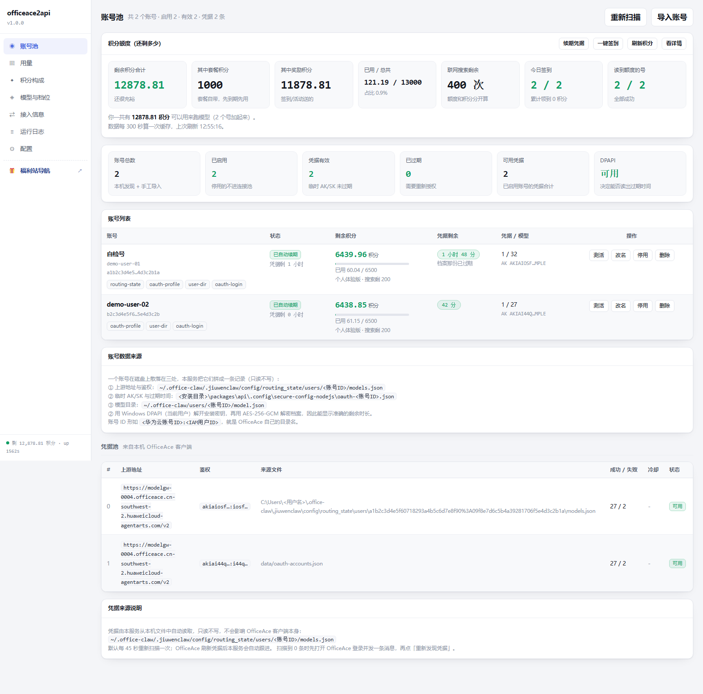

# officeace2api

**简体中文** | [English](README.en.md)

把一个模型网关反代成一整套标准 **OpenAI 兼容 API**，并自带一个中文控制台。

**零依赖** —— 只用 Node.js 内置模块，不用 `npm install`。

> ⚠️ **前置依赖**：需要安装 **OfficeAce 桌面端**（华为云 DevEco Studio 助手）并登录账号。  
> 获取方式：搜索「OfficeAce」或「华为云 DevEco」下载客户端，或从华为应用市场/官方渠道获取。  
> 本项目是桌面端的伴生服务，会自动读取桌面端的凭据文件。**如果不安装桌面端，账号授权会失败。**



---

## 一、有什么功能

### API 层

| 能力 | 说明 |
|---|---|
| `/v1/chat/completions` | 流式 SSE + 非流式 |
| `/v1/models` | 模型列表 |
| Function Calling | 工具调用原样透传 |
| `reasoning_content` | 推理模型的思维链，单独字段返回 |
| `usage` | token 统计（含 `reasoning_tokens`） |

任何能填 Base URL 的客户端都能接：Cherry Studio、NextChat、LobeChat、Cline、Roo Code、
Continue、Cursor、Dify、沉浸式翻译、OpenAI SDK……

### 控制台（`http://127.0.0.1:7864/admin`）

> 控制台默认带**面板口令**校验（首次启动自动生成，见下面的「快速开始」）。
> 打开时地址要带 `?token=`，或者请求头带 `x-admin-token`。
> 想退回"本机自用不校验"，把 `config.json` 里的 `admin.token` 改成 `""` 即可。
> （`open-panel.cmd` 会自动带上口令，日常用不用手记。）

**本机自用建议**：把带口令的地址存成书签。面板前端会从 URL 读口令并发到每个请求上，
所以收藏夹里点开就直接进，不用每次去翻 `config.json`。

| 菜单 | 干什么 |
|---|---|
| **账号池** | 多账号的凭据、剩余积分、健康度一览；一键测试 / 改名 / 停用 / 删除 |
| **用量** | 请求数、token 消耗，按模型 / 按 API Key 分组 |
| **积分构成** | 每个账号还剩多少积分 —— 直接问云端，不是估算 |
| **模型与档位** | 模型清单、别名、隐藏、手工补录；自带测试台 |
| **接入信息** | 各种客户端该填什么，一键复制 JSON / .env / curl |
| **运行日志** | 实时日志，按级别过滤 |
| **配置** | 改端口、API Key、上游、刷新间隔，存回 `config.json` |

### 自动化

- **多账号号池**：自动轮询、限流冷却、积分熔断（余额见底的号自动跳过）
- **凭据自动续期**：临时凭据到期前自动换新，不用管
- **每日自动签到**：定时领积分
- **批量注册**：给一批手机号自动注册 + 开通（可选，要接短信验证码）
- **开机自启 + 看门狗**：注册成 Windows 计划任务，进程挂了自动拉起来

---

## 二、快速开始

### 1. 环境要求

- **Windows**（启动脚本是批处理；核心是纯 Node，非 Windows 可以 `node src/index.mjs` 直接起，但桌面端自动发现和 DPAPI 解密是 Windows 专属）
- **Node.js ≥ 20**

没装 Node 也行 —— 如果你装了 OfficeAce 桌面端，启动脚本会自动用它的
`<安装目录>\tools\node\node.exe`（版本 22+）。查找顺序是：
`data\node.txt` → PATH 上的 node → 各盘 `OfficeAce\tools\node\node.exe`。

### 2. 拉下来

```bash
git clone https://github.com/Q-shuang-dot/officeace2api.git
cd officeace2api
```

第一次启动会自动生成 `config.json` 和 `data\` 目录，不用手工建。

### 3. 启动

双击 **`start.cmd`**（临时启动，关窗口不影响）：

```
[OK] service is up

  OpenAI base : http://127.0.0.1:7864/v1
  Admin panel : http://127.0.0.1:7864/admin?token=xxxxxxxxxxxxxxxxxxxxxxxxxxxxxxxx
  API key     : see "apiKeys" in config.json  (default: sk-officeace)
  Log file    : logs\server.log
```

> 控制台地址后面那串 `?token=` 是**面板口令**，首次启动自动生成并写进 `config.json`。
> 别丢掉它 —— 没有它打开面板只会看到 401。（`open-panel.cmd` 会自动带上，不用手记。）

> ⚠️ **不要直接在命令行里 `node src/index.mjs` 然后就关窗口** —— 窗口一关进程跟着死，
> 浏览器会 `ERR_CONNECTION_REFUSED`。要临时用就双击 `start.cmd`。

### 4. 加账号（**第一步是必须做的**）

**先看一眼「账号池」页再决定走哪条路** —— 它可能是空的，也可能启动完就已经有号了：

- **装了 OfficeAce 桌面端**（本机版或便携版）：服务一启动就会自动扫到那上面的账号，
  `账号池` 页直接列出来，**不用手工加**。扫的位置是 `~\.office-claw\`、各盘的
  `<盘>:\软件\OfficeAce\.office-claw`（以及 `OFFICEACE_INSTALL_DIR` 指定的目录）。
  注意后几个是**绝对路径，不跟 `USERPROFILE` 走**。
- **没装的机器**：池子是空的，**反代转发不了任何请求**，得用下面三条路之一。

**① 借用已经登录过的 OfficeAce 桌面端（推荐）**

> ⚠️ **必须先安装 OfficeAce 桌面端**（搜索「OfficeAce」或从华为应用市场获取）  
> 如果不安装桌面端，「换个账号登录」会提示「授权失败」。

登录它、随便发一条对话，然后双击 `stop.cmd` 再 `start.cmd` —— 它会自动把凭据抠出来。

**② 通过桌面端登录新账号**

如果你已经装了桌面端但服务没扫到账号：

打开控制台 →「账号池」页 → 点 **「换个账号登录」** → 浏览器里用你自己的账号登录一次。

> 💡 这个登录流程需要本机运行的 OfficeAce 桌面端处理 OAuth 回调。

**③ 兜底：手工导入**

如果你有现成的 `baseUrl` + `Authorization`（从其他地方获取），到「账号池」页点「导入账号」直接贴进去。

> 控制台里能随时看到每个号的**剩余积分**和健康度。余额见底的号会被自动跳过（积分熔断）。

### 5. 打开控制台

双击 **`open-panel.cmd`** —— 它会从 `config.json` 现算地址（含面板口令），
服务没起还会先自动拉起来。

> ⚠️ 用 **`127.0.0.1`**，别用 `localhost`。服务只监听 IPv4，而浏览器解析 `localhost`
> 会优先试 IPv6 的 `[::1]`，那里没人接 → 直接连接被拒。

### 6. 接入客户端

| 项 | 填什么 |
|---|---|
| Base URL | `http://127.0.0.1:7864/v1` |
| API Key | `sk-officeace`（**给别人用之前请在控制台「配置」里改掉**） |
| Model | 点「接入信息」一键复制，或看 `/v1/models` |

---

## 三、后台常驻（开机自启）

双击 **`install-autostart.cmd`**，注册成 Windows 计划任务 `officeace2api`：

```
[OK] scheduled task 'officeace2api' installed
[OK] will start automatically at every logon
[OK] running: http://127.0.0.1:7864/healthz
```

好处：**不依赖任何命令行窗口**，关窗口、注销、重启都不会掉，每次登录自动拉起。
任务里还套了一层看门狗（`tools\watchdog.ps1`），进程无论怎么死都会被重新拉起。

不要自启了就双击 **`remove-autostart.cmd`** 卸载。

### 常用命令

| 双击 | 作用 |
|---|---|
| `start.cmd` | 启动（已装任务就走任务，没装就后台拉起） |
| `stop.cmd` | 停止 |
| `status.cmd` | 看健康状态 + 模型列表 |
| `open-panel.cmd` | 打开控制台（服务没起会先自动启动） |
| `install-autostart.cmd` | 装成开机自启 |
| `remove-autostart.cmd` | 卸载自启 |

---

## 四、怎么加账号

四种方式，日常用第一种就够。

### ① 面板自助登录（推荐）

控制台 →「账号池」→ 右上角 **「导入账号」** → 弹出对话框：

| 按钮 | 什么时候用 |
|---|---|
| **开始登录** | 给**已有**的号续授权（云端会话还在，不用重填密码） |
| **换个账号登录** | **再加一个新号**（第二个、第三个……会先登出再让你登新的） |

点完在浏览器里登录，**登录完自己就进号池了**，不用回来点任何按钮。

### ② 从别的机器搬账号

手上有一台已经登好的机器，不想再登一次：

把目标机器 `models.json` 里的 `api_base` 和 `custom_headers.Authorization`
填进「导入账号 → 从别的机器搬账号」即可。

### ③ 批量注册

控制台 →「配置 → 授权 / 注册 → 批量注册」：给一批手机号，
服务自动注册华为云账号 + 开通 + 拉进号池。需要接一个短信验证码来源（手工填码或 HTTP 接口）。

### ④ 自动发现本机已登录的账号

如果你本机装过 OfficeAce 桌面端并登录过，启动时会自动把它的账号捞进号池，**零配置**。

---

## 五、必须装 OfficeAce 客户端吗？

**不是必须的。** 分三种情况：

| 你的情况 | 要 OfficeAce 桌面端吗 | 要做什么 |
|---|---|---|
| 已装 OfficeAce 且登过号 | 不用额外做 | 启动即用，自动发现 |
| 没装 OfficeAce，但有华为云账号 | **不需要** | 控制台「导入账号」自助登录，见上面第 ① 条 |
| 只想反代**别的** OpenAI 兼容服务 | **不需要**，华为账号也不用 | `config.json` 里填 `upstream.baseUrl` + `upstream.authorization` |

第三种情况等于把它当一个通用的 OpenAI 兼容反代来用：

```json
{
  "upstream": {
    "autoDiscover": false,
    "baseUrl": "https://你的上游/v1",
    "authorization": "Bearer sk-xxxxxxxx"
  }
}
```

控制台「配置」页也有这两个输入框（手工上游地址 / 手工鉴权头），填完保存即可。

---

## 六、常见问题

**Q：浏览器打不开，`ERR_CONNECTION_REFUSED`？**
用 `127.0.0.1:7864`，别用 `localhost:7864`。服务只绑 IPv4，浏览器优先试 IPv6 会直接拒。

**Q：`status.cmd` 说服务挂了，怎么办？**
双击 `start.cmd`，或 `install-autostart.cmd` 交给计划任务托管。日志见 `logs\server.log`。

**Q：客户端返回空正文，但有 200？**
上游把 `max_tokens` 当成「推理 + 正文」的总预算。推理模型的思维链会先把预算吃光，
正文就空了。设 `config.json` 的 `models.minMaxTokens`（默认 1024）让服务自动补足预算。
详见 [技术笔记](docs/技术笔记.md)。

**Q：模型列表里有些模型打不通？**
上游网关的目录 ≠ 每个都有权限。打不通的会返回 400 `model_not_available`，
具体哪些能用见 [技术笔记](docs/技术笔记.md)。

**Q：改了 `config.json` 要重启吗？**
端口/监听地址要重启；其余在控制台点「保存」即时生效。

**Q：数据存在哪？会上传吗？**
全在本机：`data\`（账号状态、用量、积分历史）和 `logs\`。这两个目录已在 `.gitignore` 里，
不会进仓库。服务不做任何外部上报。

---

## 七、目录结构

```
officeace2api/
├── start.cmd / stop.cmd / status.cmd      启动、停止、查看
├── install-autostart.cmd                  装成开机自启
├── open-panel.cmd                         打开控制台
├── config.json                            配置（首次启动自动生成，不进仓库）
├── src/                                   服务本体
│   ├── index.mjs       入口
│   ├── server.mjs      HTTP 路由与 API 实现
│   ├── pool.mjs        号池与轮询
│   ├── quota.mjs       积分查询 / 签到 / 熔断
│   ├── refresh.mjs     凭据自动续期
│   ├── admin.html      控制台前端（单文件）
│   └── ...
├── tools/                                 排障脚本、回归测试、看门狗
├── docs/                                  控制台截图 + 技术笔记
├── data/                                  运行期数据（不进仓库）
│   └── register-tasks.json                注册队列落盘（重启不丢任务）
└── logs/                                  日志（不进仓库，滚动留 3 份）
```

---

## 八、更多

- **[docs/技术笔记.md](docs/技术笔记.md)** —— 实现原理、OAuth/PKCE 链路、
  DPAPI 解密、V11-HMAC-SHA256 签名、推理模型 token 预算、踩过的坑，都在这里。
- `node tools/smoke-test.mjs` —— 端到端自测
- `node tools/test-admin.mjs` —— 控制台接口自测（269 项，含配置卫生：死配置检测、
  日志时间用本机时区、周期发现只在变化时说话、面板轮询后台停打、口令换 Cookie）
- `node tools/test-dpapi.mjs` —— DPAPI 解密链（13 项，起子进程真解密：真 blob 往返 /
  缓存 / 连续失败进冷却）
- `node tools/test-register.mjs` —— 批量注册状态机（36 项，不碰网络：去重 / 暂停不跑 /
  `view()` 脱敏 / 落盘与恢复）
- `node tools/test-logger.mjs` —— 日志落盘与滚动（9 项：留 3 代历史 / 本机时间列 vs
  UTC 的 `ts` / `keepRecent` 裁剪 / debug 按级别挡）
- `node tools/test-max-tokens.mjs` —— 推理预算改写规则的单元测试（71 项）
- `node tools/test-models.mjs` —— 模型注册表的大小写与去重（14 项：大小写归一 / 上游给
  同一模型两个拼法时只留一条 / 未知名字不许被"造"出来 / 别名与隐藏也大小写不敏感）
- `node tools/test-model-probe.mjs` —— 模型可用性探测的单元测试（54 项，含 **4b**：
  号池没变时只复核"打不通"的那批 —— 上游后来开了权限要能自己放回 `/v1/models`）
- `node tools/test-authflow-poll.mjs` —— 一键授权的轮询节奏测试（27 项，把 `node:https` 换成假的**数请求次数**：
  未到点不碰云端 / 四路并发只发一次 / 被限流就指数退避到 60 秒封顶 / 「还没好」不许被记成事件）
- `node tools/stress-deep41.mjs` —— 大批量压测：长会话 / 长上下文 / 高并发 / 全模型混打（会真花额度，`--all` 拉满）
- `node tools/diag-empty-window.mjs` —— 撞「推理吃光预算、正文为空」那个窗口
- `node tools/diag-upstream-limits.mjs` —— 摸上游的两条上限：messages 5000 条 / token 窗口
- `node tools/diag-body-too-large.mjs` —— 超大请求体应该回 413 而不是 429
- `node tools/diag-admin-auth.mjs` —— 核对面板鉴权（不带 / 对 / 错口令，以及 ?token= 那条路）
- `node tools/diag-portability.mjs` —— 看 data/ 里的凭据形态（判断能不能拷贝给别人）
- `node tools/diag-local-daily.mjs` —— **本机日常自用体检**：七个菜单的真实接口 + 面板调的路径是否都存在
- `node tools/diag-panel-api.mjs` —— **把面板的 `api()` 抠出来真跑**（验 `{json:{…}}` 和 `{json:true, body}` 两种写法）
- `node tools/diag-fresh-clone.mjs` —— **模拟别人 clone 下来**：只拷 git 跟踪的文件到干净目录起服务
- `node tools/diag-ghost-accounts.mjs` —— 证明 `labels` 不会造出"幽灵账号"

---

## 九、参与贡献

欢迎改进本项目！三条路：

- **只是想问问题 / 聊玩法** → 去
  [Discussions](https://github.com/Q-shuang-dot/officeace2api/discussions)，
  不适合开 Issue 的内容放这里。
- **反馈 Bug / 提建议** → 直接开
  [Issue](https://github.com/Q-shuang-dot/officeace2api/issues/new/choose)，
  有对应模板，不用写代码。
- **想改代码** → 先读 **[CONTRIBUTING.md](CONTRIBUTING.md)**，再 Fork → 建分支 → 提 PR。

> ⚠️ 动手前务必确认三条硬规矩：**零 npm 依赖**、**`.cmd` 必须纯 ASCII 无 BOM**、
> **`data/` 和 `logs/` 不许进提交**。详见 CONTRIBUTING.md 第一节。

> 🔐 发现的是**安全漏洞**（凭据泄漏、鉴权绕过等）请走
> [私下报告](https://github.com/Q-shuang-dot/officeace2api/security/advisories/new)，
> 不要开公开 Issue。

---

## License

[MIT](LICENSE)
